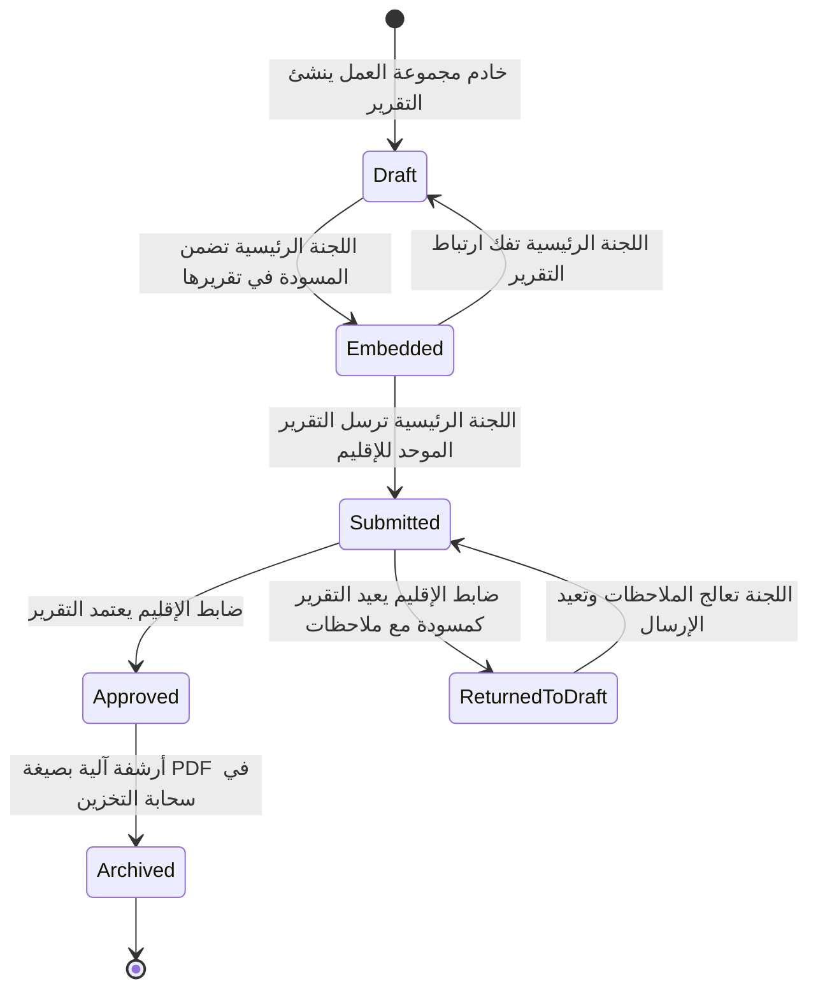

# دليل تقارير اللجان ومجموعات العمل - زمالة المدمنين المجهولين بمصر
# Committee Reports & Workgroups Manual - NA Egypt Fellowship

---

> **اللغة / Language:**  
> - [الجزء الأول: الدليل الشامل باللغة العربية (Arabic Version)](#الجزء-الأول-الدليل-الشامل-باللغة-العربية)
> - [Part Two: Comprehensive English Manual](#part-two-comprehensive-english-manual)
>
> 🌐 **الوصول المباشر في النظام / In-Portal Access:**  
> متاح مباشرة لكافة أعضاء لجان الخدمة ومجموعات العمل في القائمة الجانبية للبوابة تحت **"التقارير والأجندات" (Reports & Agendas)** أو عبر الرابط: [`/committee-reports-guide`](https://naegypt.org/committee-reports-guide).

---

# الجزء الأول: الدليل الشامل باللغة العربية

## ١. الهيكل الخدمي ومفهوم مجموعات العمل (Workgroups)

وفقاً لدليل الخدمة في زمالة المدمنين المجهولين (NA Guide to Service)، تقوم لجان خدمة الإقليم ولجان المناطق بتشكيل **مجموعات عمل (Workgroups)** لمعالجة مهام وأهداف ومشاريع محددة:

```
                    ┌──────────────────────────────────────────────┐
                    │      لجنة خدمة الإقليم (RSC / ID: 83)        │
                    │   RSC Officers (RSC, RCP, RVCP, ARSC...)     │
                    └──────────────────────┬───────────────────────┘
                                           │
         ┌─────────────────────────────────┴─────────────────────────────────┐
         │                                                                   │
┌────────┴──────────────────────────┐                       ┌────────────────┴─────────────────┐
│     لجان خدمة الإقليم الرئيسية     │                       │     مجموعات عمل الإقليم التابعة    │
│  (مثل: الترجمة، النشريات، المستشفيات)│                       │   (مثل: مجموعة عمل تكنولوجيا IT)   │
└────────────────┬──────────────────┘                       └──────────────────────────────────┘
                 │
  ┌──────────────┴──────────────┐
  │  مجموعات عمل اللجان الفرعية  │
  │ (مثل: مجموعة عمل ترجمة كتاب) │
  └─────────────────────────────┘
```

### القواعد الهيكلية الأساسية في النظام:
1. **التبعية الهرمية (Parent-Child Hierarchy):** كل مجموعة عمل تتبع لجنة خدمة رئيسية (`parent_id != null`).
2. **فصل الأدوار والصلاحيات (Role Segregation):**
   - خدام مجموعات العمل يحملون دوراً مخصصاً هو `Workgroups`.
   - لجان الخدمة الرئيسية تحمل دور `Committees`.
   - ضباط الإقليم يحملون دور `rsc` ويمثلون لجنة خدمة الإقليم (`id: 83`).
   - الإدارة العليا تحمل دور `super admin`.
3. **نطاق الرؤية والإشراف (Scoping Standards):**
   - **اللجنة الرئيسية:** تمتلك الإشراف الكامل (عرض، إضافة، تعديل، حذف) على جميع مجموعات العمل التابعة لها وتقاريرها.
   - **خادم مجموعة العمل:** يقتصر وصوله بشكل حصري على تفاصيل واجتماعات ومسودات مجموعة العمل المسندة إليه فقط. وعند الدخول للنظام يتم توجيهه تلقائياً إلى صفحته.
   - **ضباط الإقليم (`rsc`):** ينحصر نطاق إدارة مجموعات العمل الخاصة بهم في مجموعات العمل التابعة مباشرة للجنة الإقليم (لجنة 83، مثل مجموعة عمل IT)، حمايةً لاستقلالية اللجان الأخرى، ما لم يكن المستخدم حاملاً لصلاحية المدير العام `super admin`.
4. **مرونة البيانات الجغرافية:** العناوين المادية الفعلية (`ar_address`, `en_address`) اختيارية لمجموعات العمل، نظراً لأن أغلبها يُعقد افتراضياً (أونلاين) أو في مقرات متغيرة.

---

## ٢. دورة حياة التقارير والتضمين الهرمي (Embedding Lifecycle)

أحد أهم الأسس البرمجية والخدمية في بوابة NA Egypt هو **حظر تقديم تقارير مجموعات العمل مباشرة إلى الإقليم**؛ بل تمر عبر دورة التضمين التالية:



### حالات التقرير الأربعة:
1. **مسودة (`draft`):** تقرير داخلي قيد الإعداد. تقارير مجموعات العمل **تُحفظ دائماً وتلقائياً كمسودة** ولا يمكن تحويلها لمرسل.
2. **مُضمَّن (`embedded`):** تقرير مجموعة عمل تم اختياره وإدراجه داخل تقرير اللجنة الرئيسية عبر الربط بـ `parent_report_id`.
3. **مُرسَل (`submitted`):** تقرير رسمي تم إرساله من اللجنة الرئيسية إلى قائمة مراجعة الإقليم (RSC Review Queue)، ويصاحبه إشعار بريدي تلقائي إلى `rsc@naegypt.org` و `arsc@naegypt.org`.
4. **مُعتمد (`approved`):** تقرير اعتمده ضابط الإقليم ونُشر رسمياً، ويتم توليد ملف PDF له فوراً وأرشفته آلياً في قرص التخزين السحابي `storagebox`.

---

## ٣. دليل الاستخدام: خادم مجموعة العمل (Workgroups Role)

### أ. تسجيل الدخول والوصول المباشر
- بمجرد تسجيل دخولك بحساب مجموعة العمل الخاص بك، يقوم النظام بتوجيهك تلقائياً إلى صفحة تفاصيل مجموعة العمل (`/workgroup/show/{id}`).
- يظهر لك ملخص بيانات المجموعة: الاسم، اللجنة التابعة لها، المنسق، حالة المجموعة (دائمة/مؤقتة)، والاجتماعات المرتبطة.

### ب. إنشاء تقرير دوري لمجموعة العمل
1. انتقل إلى **تقارير اللجان** (`/committee-reports`) واضغط على **"إضافة تقرير" (Add Report)**.
2. ستجد أن النظام قام بتحديد لجنتك تلقائياً، ومنع اختيار لجان أخرى.
3. قم بتعبئة بيانات الاجتماع:
   - **تاريخ الاجتماع (Meeting Date):** تاريخ انعقاد اجتماع مجموعة العمل.
   - **وصف يوم الاجتماع (Meeting Day Description):** مثل: *"الأحد الأول من كل شهر"* أو *"اجتماع طارئ لمشروع التطبيق"*.
   - **اجتماع استثنائي (Exceptional):** حدد هذا الخيار إذا كان الاجتماع طارئاً أو خارج الجدول الدوري المعتاد.
4. **أقسام التقرير الديناميكية (Dynamic Sections):**
   - يمكنك إضافة عنوان رئيسي لكل قسم (مثل: *ما تم إنجازه*، *التحديات*، *الاحتياجات المالية*).
   - اكتب التفاصيل في خانة المحتوى. يمكنك استخدام زر **"+ إضافة قسم"** لإضافة أي عدد تريده من الأقسام.
5. **بيانات خدام المجموعة وشواغر المهام (Positions Status):**
   - اضغط على **"+ إضافة خادم / موقع"** لتسجيل المنسق، أمين السر، أو أمين الصندوق، مع تحديد الحالة (*شاغر Vacant* أو *ممتلئ Filled*) وتاريخ الانتخاب.
6. **الأعضاء الحاضرون (Attended Members):** تسجيل أسماء الزملاء المشاركين في الاجتماع.
7. **المرفقات (Attachments):** يمكنك رفع حتى **5 ملفات** (PDF، صور، جداول Excel، مستندات Word بحد أقصى 5 ميجابايت للملف).
8. **حفظ التقرير:**
   > [!IMPORTANT]
   > لا تملك مجموعات العمل خيار إرسال التقرير للإقليم. يقوم النظام بحفظ تقريرك كـ **مسودة (Draft)** لتطلع عليه لجنتك الرئيسية وتقوم بتضمينه.

---

## ٤. دليل الاستخدام: لجنة الخدمة الرئيسية (Committees Role)

### أ. إدارة مجموعات العمل التابعة للجنة
1. من القائمة الجانبية، اختر **"مجموعات عملي" (My Workgroups)** للوصول إلى لوحة إدارة مجموعات العمل (`/workgroup`).
2. لإضافة مجموعة عمل فرعية جديدة:
   - اضغط على زر **"إضافة مجموعة عمل" (Add Workgroup)**.
   - اكتب الاسم بالعربية والإنجليزية (مثل: *مجموعة عمل إعداد كتيب التعافي*).
   - حدد نوعها: **دائمة (Permanent)** أو **مؤقتة (Temporary)** لمشروع ينتهي بتاريخ محدد.
   - حدد منسق المجموعة وبيانات الاتصال والبريد الإلكتروني (يقوم النظام تلقائياً بمنح الحساب دور `Workgroups`).
   - يمكنك إرفاق شعار مخصص للمجموعة وإضافة تذييل افتراضي للتقارير (Default Footer).

### ب. استعراض مسودات مجموعات العمل وإشعار التنبيه
- عندما يقوم خادم أي مجموعة عمل بحفظ تقرير مسودة، يظهر للجنة الرئيسية تنبيه مرئي أصفر في أعلى شاشة التقارير:
  `🔔 لديك [عدد] تقارير مسودة من مجموعات العمل التابعة بانتظار المراجعة والتضمين`
- يمكنك الضغط على تبويب **"مسودات مجموعات العمل" (Workgroup Drafts)** لقراءة ومراجعة مسوداتهم قبل إعداد التقرير الموحد.

### ج. إعداد تقرير اللجنة الرئيسي وتضمين تقارير مجموعات العمل
1. اضغط على **"إضافة تقرير" (Add Report)** أو قم بتعديل مسودة تقرير لجنتك الحالية.
2. ستجد قسماً مخصصاً بعنوان: **"تضمين تقارير مجموعات العمل" (Embed Workgroup Reports)**.
3. يعرض النظام بطاقات كافة المسودات المتاحة وغير المضمنة التابعة لمجموعات عملك:
   - يعرض تاريخ الاجتماع، ملخص الأقسام، وعدد المرفقات.
   - ضع علامة (✓) بجوار التقارير التي قررت اللجنة اعتمادها وإدراجها ضمن تقرير هذا الشهر.
4. بمجرد حفظ أو إرسال تقرير لجنتك:
   - تتحول حالة تقارير مجموعات العمل المختارة إلى **مُضمَّنة (`embedded`)**.
   - يتم ربطها تلقائياً بالتقرير الرئيسي (`parent_report_id`).
   - تدمج بياناتها ومرفقاتها تلقائياً داخل التقرير الموحد وملف الـ PDF الرسمي المرسل للإقليم!
5. **إمكانية التراجع أو فك التضمين:** إذا قمت بتعديل تقرير لجنتك وأزلت علامة (✓) عن تقرير مجموعة عمل، يعيده النظام تلقائياً إلى حالة مسودة مستقلة (`draft`) ليكون متاحاً للشهر التالي.

### د. تقديم التقرير الرسمي للإقليم (Submit to RSC)
- عند اكتمال بيانات التقرير ومراجعة التضمينات، يمكنك اختيار الحالة **"مُرسل" (Submitted)** أو الضغط على زر **"إرسال إلى لجنة خدمة الإقليم"** في تفاصيل التقرير.
- يتم إرسال إشعار بريدي فوري لضباط الإقليم، وتُقفل إمكانية التعديل على التقرير حتى يتم اعتماده أو إرجاعه بملاحظات.

---

## ٥. دليل الاستخدام: ضباط الإقليم والإدارة (RSC & Super Admin)

### أ. طابور مراجعة تقارير اللجان (RSC Review Queue)
- عند دخول ضابط الإقليم (`rsc`) أو المدير العام (`super admin`) إلى صفحة التقارير، يقتصر الطابور الرسمي على تقارير اللجان الرئيسية المقدمة أو المعتمدة (`submitted`, `approved`) لمنع التشويش بمسودات مجموعات العمل الداخلية.
- يمكن التصفية حسب اسم اللجنة، تاريخ الاجتماع، أو نوع الاجتماع الاستثنائي.

### ب. اعتماد التقرير والأرشفة التلقائية (Approve & Archive)
1. يراجع ضابط الإقليم التقرير، وعند الموافقة يضغط على **"اعتماد ونشر" (Approve & Publish)**.
2. ينفذ النظام فوراً الإجراءات التالية:
   - تحويل حالة التقرير إلى **مُعتمد (`approved`)**.
   - استدعاء خدمة الأرشفة السحابية (`ReportArchiver`).
   - توليد ملف PDF متكامل التنسيق يشمل بيانات اللجنة، الأعضاء، شواغر المهام، أقسام التقرير، وتقارير مجموعات العمل المضمنة.
   - تخزين التقرير ومرفقاته آلياً في المجلد المناسب داخل قرص سحابة التخزين `storagebox` وفق الهيكل الهرمي الرسمي لأرشيف الإقليم.

### ج. إرجاع التقرير كمسودة مع ملاحظات (Return to Draft with Review Notes)
1. إذا تبيّن لضابط الإقليم وجود نقص أو حاجة لتعديل بند في التقرير، يضغط على زر **"إرجاع كمسودة مع ملاحظات" (Return to Draft)**.
2. يُلزم النظام ضابط الإقليم بكتابة **ملاحظات المراجعة (Review Notes)** توضح أسباب الإرجاع وما يجب استيفاؤه.
3. يعود التقرير للجنة الرئيسية بحالة مسودة، ويظهر تنبيه أحمر في شاشتهم متضمناً نص الملاحظات حتى تقوم اللجنة بالتعديل وإعادة التقديم.

### د. استعراض سجلات التدقيق (Audit Logs)
- للمدير العام (`super admin`) عبر زر **"سجلات التدقيق" (Audit Logs)**:
  - استعراض جدول زمني دقيق لكل حركة تمت على التقارير (`created`, `updated`, `submitted`, `approved`, `returned_to_draft`, `deleted`).
  - هوية المستخدم الذي نفذ الإجراء، البريد الإلكتروني، التاريخ والوقت بالثانية، والتفاصيل المتغيرة (تاريخ الاجتماع، عدد المرفقات، تغير الحالة).

---

## ٦. محرك الأرشيف والتخزين السحابي (Storagebox Archive Engine)

يتيح النظام للمستخدمين تصفح أرشيف التقارير التاريخية عبر شاشة **"أرشيف التقارير" (Reports Archive)**:

```
Archives (أرشيف الإقليم)
 └── أجندة إجتماع لجنة خدمة الاقليم
      └── 2026
           └── أجندة مايو 2026
                └── التقارير الشهرية حتى 10 مايو 2026
                     ├── لجنة الترجمة
                     │    ├── report_124_2026-05-02.pdf (تقرير اللجنة المعتمد)
                     │    └── المرفقات/ (المستندات والملفات المرفقة)
                     └── لجنة النشريات
```

- **تكامل السحابة وقاعدة البيانات:** يدمج المتصفح تلقائياً بين الملفات التاريخية المخزنة على قرص `storagebox` وبين التقارير الحديثة المولدة برمجياً.
- **الحماية والأمان:** روابط التنزيل محمية بتشفير عالي الأمان `Crypt::encryptString`، مع فحص لمنع تسريب مسارات الملفات (Path Traversal Protection).
- **قاعدة إتاحة التقارير لممثلي المجموعات والمناطق (10th of Next Month):**
  > [!NOTE]
  > حمايةً لمداولات الخدمة الجارية، تصبح التقارير المعتمدة مرئية ومتاحة للتنزيل لحسابات لجان المناطق وممثلي المجموعات (`ServiceBody`, `gsr`) في **اليوم العاشر من الشهر التالي** لتاريخ انعقاد الاجتماع.

---

## ٧. سيناريوهات عملية من واقع الخدمة

### سيناريو (أ): مجموعة عمل تكنولوجيا المعلومات (IT Workgroup) ولجنة الإقليم (RSC 83)
1. يجتمع خادم مجموعة عمل تكنولوجيا المعلومات ويوثق صيانة خوادم البوابة والاجتماعات في تقرير بتاريخ 28 أبريل.
2. يقوم الخادم بحفظ التقرير، فيُسجل في النظام كمسودة تابعة لمجموعة عمل IT.
3. يدخل ضابط الإقليم (أمين صندوق أو نائب المنسق) لإعداد التقرير الشهري للجنة الإقليم (ID: 83).
4. يجد تقرير مجموعة عمل IT في قسم التضمين، فيضع علامة (✓) لتضمينه.
5. يصدر تقرير الإقليم شاملاً إنجازات تكنولوجيا المعلومات ويرسل رسمياً.

### سيناريو (ب): لجنة الترجمة الفرعية وإعادة التقرير بملاحظات
1. أنشأت لجنة الترجمة مجموعة عمل مخصصة باسم *"مجموعة عمل ترجمة دليل الخدمة الجديد"*.
2. قدمت مجموعة العمل مسودة تتضمن شراء قواميس ومسودات فصول.
3. قامت لجنة الترجمة بتضمين المسودة وقدمت التقرير للإقليم.
4. لاحظ ضابط الإقليم عدم إرفاق إيصالات المصروفات؛ فقام بالضغط على "إرجاع كمسودة" ودون: *"يرجى إرفاق إيصالات شراء القواميس في المرفقات"*.
5. دخلت لجنة الترجمة، ووجدت التقرير متاحاً للتعديل مع الملاحظة، فقامت برفع ملف الفواتير عبر خانة المرفقات وأعادت إرسال التقرير، ليقوم الإقليم باعتماده وأرشفته فوراً.

---

## ٨. مصفوفة قواعد التحقق والحقول (Validation Matrix)

| الحقل / العنصر | نوع البيانات | الإلزامية | القيود والشروط |
| :--- | :--- | :--- | :--- |
| `meeting_date` | Date | إلزامي | تاريخ صالح لانعقاد الاجتماع |
| `meeting_day_description` | String | إلزامي | حد أقصى 255 حرفاً (مثال: السبت الثاني من الشهر) |
| `sections` | Array | إلزامي | يجب أن يحتوي على قسم واحد على الأقل مع محتوى نصي |
| `sections.*.headline` | String | اختياري | عنوان القسم (حد أقصى 255 حرفاً) |
| `sections.*.content` | Text | إلزامي | نص التقرير ومحتوى القسم |
| `positions` | Array | اختياري | مصفوفة لتتبع المواقع والشواغر والانتخابات |
| `status` | String | إلزامي | `draft`، `submitted`، `approved` (مجموعات العمل محصورة بـ `draft`) |
| `attachments` | Files | اختياري | حد أقصى 5 ملفات، صيغ (pdf, png, jpg, jpeg, docx, xlsx)، حد أقصى 5MB للملف |
| `embedded_workgroup_report_ids` | Array | اختياري | معرفات صالحة لتقارير مسودة تخص مجموعات العمل التابعة للجنة فقط |
| `review_notes` | Text | إلزامي عند الإرجاع | حد أقصى 1000 حرف لتوضيح ملاحظات الإقليم |

---

# Part Two: Comprehensive English Manual

## 1. Service Hierarchy & Workgroups Architecture

In accordance with the NA Guide to Service, Regional Service Committees and Area Service Committees establish **Workgroups** to carry out specific, targeted tasks and operational projects:

- **Workgroups as Sub-Entities:** Every workgroup is linked to a parent Service Committee (`parent_id != null`).
- **Role Isolation:**
  - Workgroup officers hold the dedicated `Workgroups` role.
  - Parent committees hold the `Committees` role.
  - Regional officers hold the `rsc` role representing Committee `83`.
  - Platform administrators hold `super admin`.
- **Hierarchical Scoping Standards:**
  - Parent committees maintain full visibility (view, create, edit, delete) over all child workgroups and their reports.
  - Workgroup users are strictly scoped to their own assigned workgroup details, recovery/business meetings, and internal draft reports.
  - RSC officers are scoped strictly to Committee 83 workgroups (e.g. IT Workgroup), maintaining committee independence.
- **Address Field Flexibility:** Physical addresses (`ar_address`, `en_address`) are nullable and optional for workgroups.

---

## 2. Report Lifecycle & Embedding Pipeline

Workgroups are structurally barred from submitting reports directly to the Regional Service Committee. Instead, they follow an **Embedding Lifecycle**:

1. **Draft Phase (`draft`):** The workgroup servant drafts the report. Reports belonging to workgroups are **strictly enforced as draft**.
2. **Review & Embedding Phase (`embedded`):** The parent committee reviews all unembedded drafts in their dashboard. When compiling their monthly committee report, they select the active workgroup drafts. The selected reports transition to `embedded` status and link via `parent_report_id`.
3. **Submission Phase (`submitted`):** The parent committee submits their unified report to the RSC Review Queue. An automatic email notification is dispatched to `rsc@naegypt.org` and `arsc@naegypt.org`.
4. **Approval & Cloud Archiving (`approved`):** An RSC officer reviews and approves the report. The system instantly generates an mPDF document and archives both the report and its attachments into the appropriate hierarchical path on the `storagebox` cloud disk.
5. **Return to Draft (`draft` with `review_notes`):** If revisions are necessary, the RSC returns the report to draft with mandatory review notes explaining the required updates.

---

## 3. Workgroup Servants Guide (`Workgroups` Role)

### Direct Portal Access
- When logging in with a workgroup account, the system automatically redirects you to `/workgroup/show/{id}`.
- View your workgroup status (permanent/temporary), assigned chairman, and linked recovery or business meetings.

### Drafting a Workgroup Report
1. Navigate to **Committee Reports** (`/committee-reports`) and click **Add Report**.
2. Committee assignment is pre-locked to your specific workgroup.
3. Fill in the **Meeting Date** and a human-readable **Meeting Day Description** (e.g., *"First Tuesday after Area meeting"*).
4. If this was an emergency or special session, toggle **Exceptional Meeting**.
5. Add **Dynamic Sections**:
   - Provide an optional Headline (e.g., *Achievements*, *Challenges*, *Financials*).
   - Enter detailed text content. Use **+ Add Section** to add multiple topics.
6. Record servant roster in **Positions Status** (*Vacant* or *Filled* along with election dates).
7. Upload up to **5 attachments** (PDF, images, spreadsheets, or documents under 5MB each).
8. Click **Save**: The report is saved as `draft` and immediately becomes visible to your parent committee.

---

## 4. Parent Service Committees Guide (`Committees` Role)

### Managing Child Workgroups
1. Open **My Workgroups** (`/workgroup`) from the sidebar.
2. Click **Add Workgroup** to register a new child body:
   - Provide Arabic and English titles.
   - Choose type: **Permanent** (ongoing operations) or **Temporary** (fixed-duration project).
   - Assign an officer email: The system automatically grants the user the `Workgroups` role.
   - Optionally attach a logo and default report footer.

### Embedding Workgroup Drafts into Committee Reports
- An alert banner alerts you on `/committee-reports` whenever child workgroups have unembedded drafts:
  `🔔 Pending Workgroup Reports Notice: X active drafts ready for review`
- Click the **Workgroup Drafts** tab to inspect each draft before embedding.
- In your committee report creation or editing form:
  - Check the boxes under **Embed Workgroup Reports** for the drafts to integrate.
  - Saving your report links them via `parent_report_id` and transitions their status to `embedded`.
  - If you uncheck a report, it detaches and reverts back to `draft` without data loss.

### Submitting to RSC
- Click **Submit to Regional Service Committee** or save with status `submitted`.
- The report locks against editing and enters the RSC review queue.

---

## 5. RSC Officers & Administrators Guide (`rsc` & `super admin`)

### RSC Review Queue
- The RSC review dashboard displays all official committee reports in `submitted` or `approved` state.
- Standalone child workgroup drafts are excluded from this queue to prevent uncluttered oversight.

### Approving and Cloud Archiving
- Click **Approve & Publish**.
- Status transitions to `approved`.
- `ReportArchiver` triggers in the background:
  - Generates a branded bilingual PDF with full header, body sections, positions, and embedded workgroup content.
  - Saves the PDF and all original attachments directly to the Hetzner Storagebox disk under:
    `Archives/أجندة إجتماع لجنة خدمة الاقليم/{Year}/أجندة {Month} {Year}/التقارير الشهرية حتى 10 {Month} {Year}/{Committee_Name}/`

### Returning with Review Notes
- Click **Return to Draft**.
- A modal prompts for mandatory **Review Notes** explaining what corrections or receipts are required.
- The committee receives the draft back with a clear warning alert displaying the feedback.

### Audit Logs (`committee_report_logs`)
- Administrators can review the immutable event log (`/committee-reports/logs`):
  - Every transition (`created`, `updated`, `submitted`, `approved`, `returned_to_draft`, `deleted`) is logged with timestamp, user ID, email, IP, and JSON metadata diff.

---

## 6. Access Control & Restricted Consumers Rule

To maintain operational integrity and fellowship process:
- **Drafts:** Visible only to the owning entity, parent committee, and super admin.
- **Submitted Reports:** Visible to committees, RSC officers, and super admin.
- **Approved Reports for GSRs and Service Bodies:**
  > [!IMPORTANT]
  > Users with roles `ServiceBody` (Area ASCs) and `gsr` (Group Service Representatives) are restricted consumers. Approved reports become visible to them strictly on the **10th day of the month following the meeting date**.

---

## 7. Troubleshooting & FAQ

**Q1: Why cannot my workgroup submit directly to RSC?**  
*Answer:* Workgroups are accountable to their parent committee. The parent committee must review, approve, and embed the workgroup's report into their master report before sending it to the Regional Service Committee.

**Q2: What happens if a parent committee deletes a draft report that has embedded workgroup reports?**  
*Answer:* The system safely unlinks all embedded workgroup reports, resets their `parent_report_id` to `null`, and reverts their status back to `draft` so their data is never lost.

**Q3: Can a workgroup have recovery or business meetings?**  
*Answer:* Yes. Workgroups can have scheduled meetings in the system just like committees, displayed on their detail page with full timing and recurrence controls.

**Q4: How do I export multiple reports at once?**  
*Answer:* In the Committee Reports index or Archive, select the desired reports and use the **Export Selected as PDF** action to download a single combined booklet.

