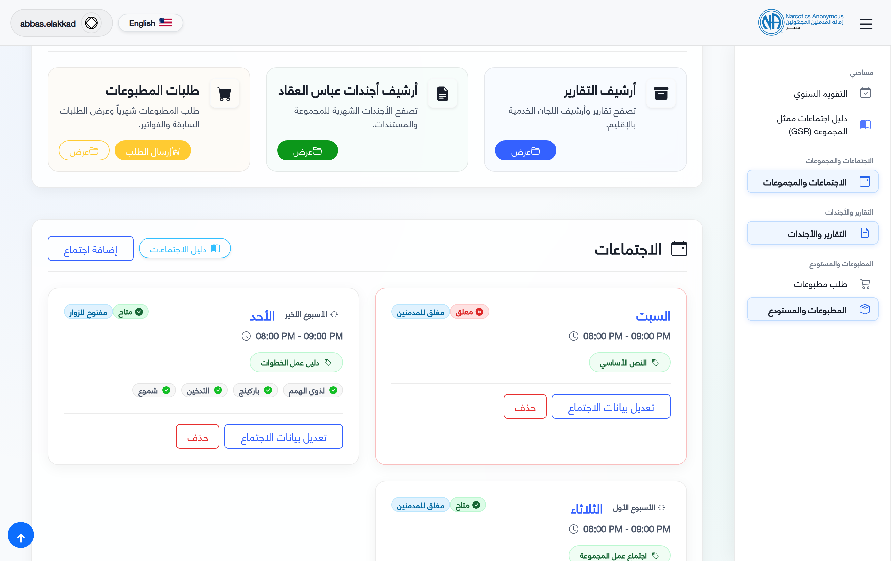
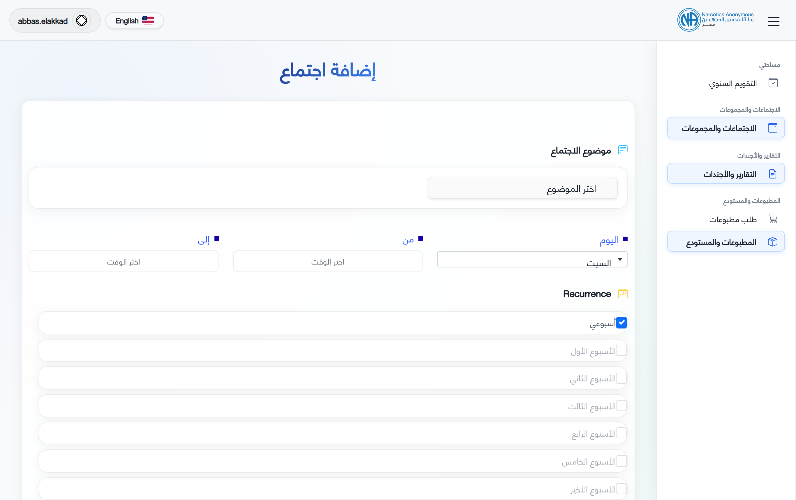
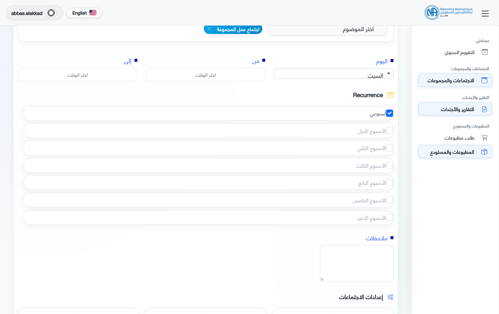
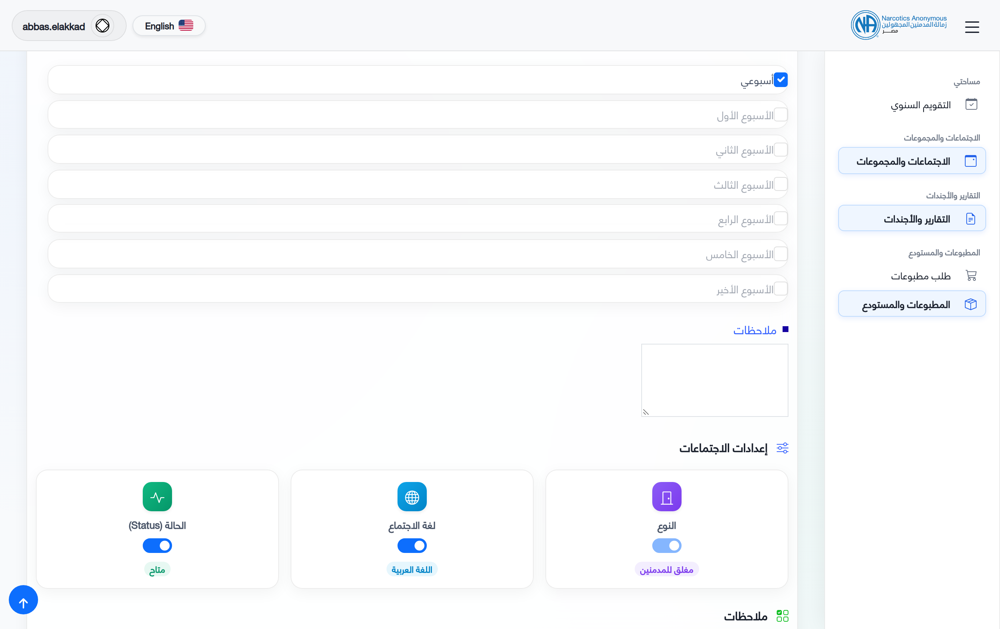
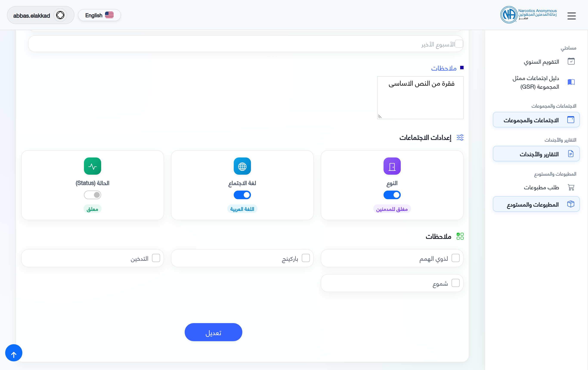
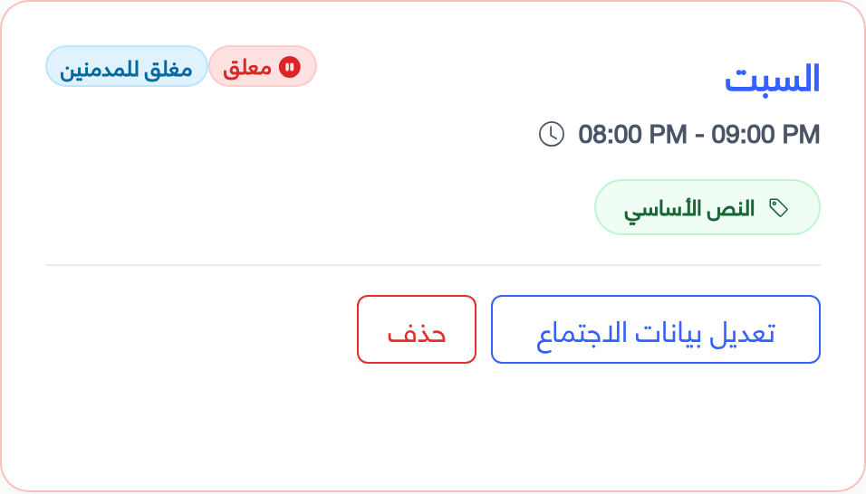
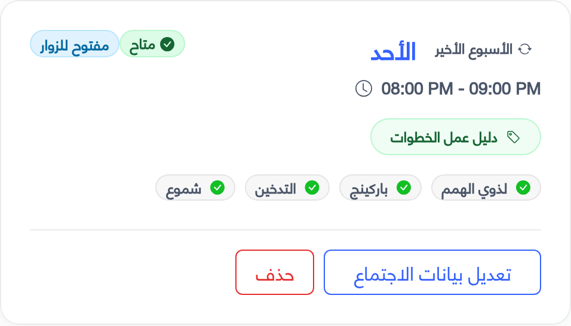
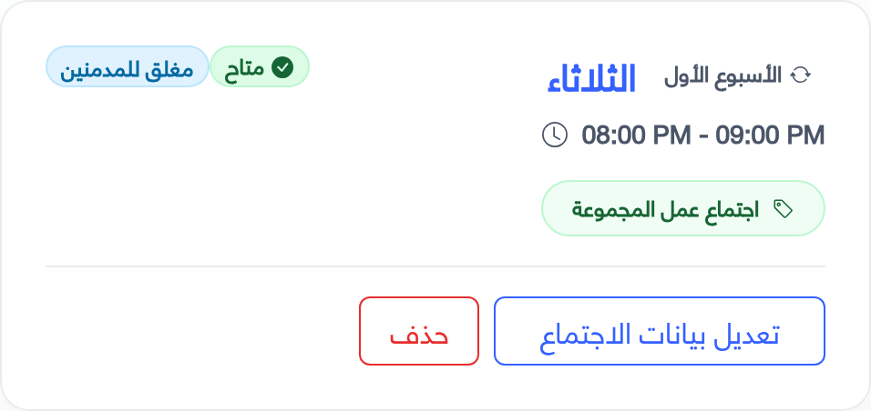
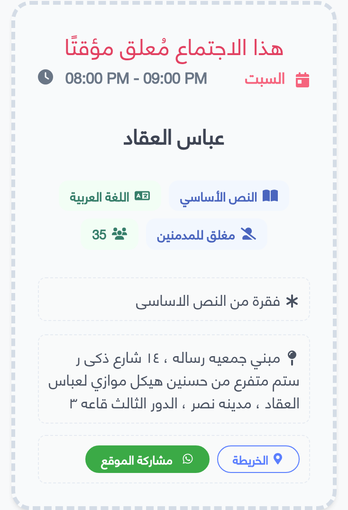
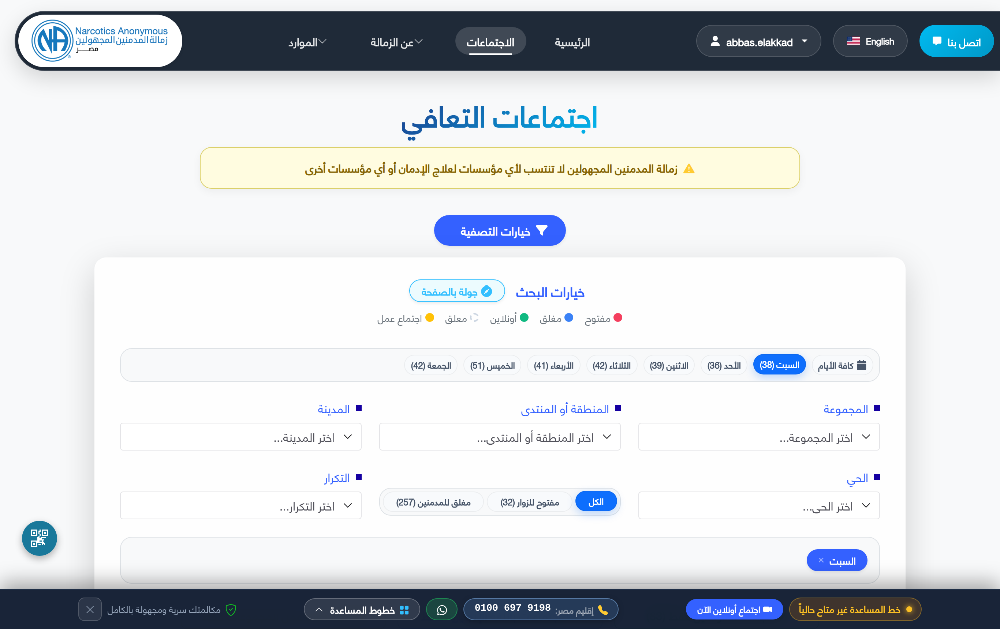

# دليل ممثل خدمة المجموعة (GSR) - إدارة اجتماعات التعافي
# Group Service Representative (GSR) Guide - Meetings Management

---

> **اللغة / Language:**  
> - [الجزء الأول: الدليل باللغة العربية (Arabic Version)](#الجزء-الأول-دليل-ممثل-خدمة-المجموعة-باللغة-العربية)
> - [Part Two: English Version](#part-two-group-service-representative-gsr-guide-in-english)
>
> 🌐 **الوصول المباشر في النظام / In-Portal Access:**  
> متاح مباشرة لممثلي المجموعات في القائمة الجانبية للبوابة تحت **"مساحة عملي" (My Workspace)** أو عبر الرابط: [`/gsr-guide`](https://naegypt.org/gsr-guide).

---

# الجزء الأول: دليل ممثل خدمة المجموعة باللغة العربية

## ١. مقدمة وصلاحيات ممثل خدمة المجموعة (GSR)

أخي/أختي ممثل خدمة المجموعة (GSR):  
مرحباً بك في بوابة خدمة زمالة المدمنين المجهولين بمصر (NA Egypt). يُمثّل دورك حلقة الوصل الحيوية بين مجموعتك المتمتعة بالاستقلالية الذاتية وبين هيكل الخدمة ككل (لجنة خدمة المنطقة ASC ومؤتمر خدمة الإقليم RSC).

وفقاً لمفهوم الخدمة وإرشادات الزمالة، فإن أحد أهم مسؤوليات المجموعة وممثلها هو **الحفاظ على دقة وتحديث مواعيد ومواقع اجتماعات التعافي**، حتى يجد المدمن الجديد الباحث عن التعافي الباب مفتوحاً والميعاد دقيقاً في أي وقت.

### صلاحيات حساب الـ GSR في النظام:
1. **الوصول التلقائي للمجموعة:** عند تسجيل دخولك بحساب الـ GSR الخاص بمجموعتك، يقوم النظام تلقائياً بتوجيهك إلى صفحة تفاصيل مجموعتك (`/group/show/{id}`).
2. **رابط الدليل المباشر في القائمة:** يظهر رابط هذا الدليل بصورة دائمة في القائمة الجانبية تحت **"مساحة عملي" (My Workspace)** للرجوع إليه في أي وقت.
3. **إدارة الاجتماعات المستقلة:** يملك حساب الـ GSR الصلاحية الكاملة لإضافة، تعديل، تعليق، أو حذف أي اجتماع تعافي تابع لمجموعته حصراً.
4. **تحديث بيانات المجموعة وتجهيز جدول الأعمال:** تحديث بيانات التواصل الخاصة بالمجموعة، وتقديم تقرير المجموعة الدوري للجنة خدمة المنطقة (ASC Agenda).

---

## ٢. واجهة إدارة المجموعة وقسم الاجتماعات

عند تسجيل الدخول، تظهر لك شاشة **بيانات المجموعة (Group Details)** وبها الأقسام التالية:

1. **بطاقة بيانات المجموعة الرئيسية:**
   - اسم المجموعة (بالعربية والإنجليزية).
   - لجنة خدمة المنطقة التابعة لها (Service Body).
   - الحي / المنطقة الجغرافية (Neighborhood).
   - سعة القاعة التقديرية (Capacity).
   - أسماء ممثلي المجموعة (GSR Name بالعربية والإنجليزية).
   - رابط خرائط جوجل أو الرابط الجغرافي للمقر (Location URL).
   - بيانات التواصل (البريد الإلكتروني ورقم الهاتف).
   > **ملاحظة هامة:** إذا تغيّر مقر المجموعة أو عنوانها الفعلي أو رقم الهاتف، يتم تعديله من خلال زر **"تعديل المجموعة" (Edit Group)** في أعلى بطاقة المجموعة، وليس من داخل إعدادات الاجتماع الفردي.

2. **قسم اجتماعات التعافي (Meetings Section):**
   - يعرض بطاقات كافة الاجتماعات المسجلة للمجموعة مرتبة حسب اليوم والوقت.
   - يحتوي على زر بارز: **"إضافة اجتماع" (`+ Add Meeting`)**، وبجواره زر **"دليل الاجتماعات"**.
   - يتيح زري **"تعديل بيانات الاجتماع" (Edit Meeting)** و **"حذف" (Delete)** لكل اجتماع.

3. **قسم جدول أعمال المجموعة (Agendas):**
   - يتيح تجهيز وتقديم تقرير المجموعة الدوري للجنة خدمة المنطقة قبل انعقاد الاجتماع الدوري للمنطقة.

### لقطة توضيحية (١): قسم الاجتماعات في لوحة تحكم المجموعة

---

## ٣. خطوات إضافة اجتماع تعافي جديد (Add Meeting)

لإضافة اجتماع تعافي جديد لمجموعتك، اتبع الخطوات التالية:

### الخطوة الأولى: فتح النموذج
من صفحة تفاصيل المجموعة، انقر على زر **"إضافة اجتماع" (Add Meeting)** في ترويسة قسم الاجتماعات. سيتم نقلك إلى الرابط: `/meeting/create`.

### الخطوة الثانية: تحديد اليوم والمواعيد ونمط التكرار
1. **اليوم (Day):** اختر يوم انعقاد الاجتماع من القائمة (السبت، الأحد، الإثنين، الثلاثاء، الأربعاء، الخميس، الجمعة).
2. **وقت البدء (From):** حدد وقت بداية الاجتماع بالساعة والدقيقة والفترة (صباحاً AM / مساءً PM).
3. **وقت الانتهاء (To):** حدد وقت نهاية الاجتماع *(شرط النظام: يجب أن يكون وقت الانتهاء لاحقاً لوقت البدء)*.
4. **نمط التكرار (Recurrence):**
   - **أسبوعي (Weekly):** للاجتماعات الدورية التي تُعقد أسبوعياً بانتظام.
   - **تكرار شهري مخصص (Specific Monthly Weeks):** (الأول، الثاني، الثالث، الرابع، الخامس، الأخير).

> [!WARNING]
> **شرط التكرار الحصري:** لا يمكن الجمع بين خيار **"أسبوعي" (Weekly)** وخيارات الأسابيع المحددة في نفس الوقت. إذا كان الاجتماع أسبوعياً، حدد "أسبوعي" فقط.

### لقطة توضيحية (٢): نموذج تحديد اليوم والمواعيد والتكرار

---

### الخطوة الثالثة: اختيار موضوع الاجتماع (Meeting Topic)
- يتيح لك النظام اختيار موضوع الاجتماع عبر قائمة منسدلة ذكية تدعم إضافة حتى **3 مواضيع** كحد أقصى (مثل: *خطوات/متحدث*، *مشاركات مفتوحة*، *النص الأساسي*، *تأمل*، إلخ).
- بمجرد اختيار الموضوع من القائمة، يظهر كعلامة (Tag) زرقاء مع خيار الحذف السريع (`×`).

> [!IMPORTANT]
> **قاعدة حصرية لاجتماع عمل المجموعة (Group Business Meeting):**  
> إذا كان الاجتماع مخصصاً لـ **"اجتماع عمل المجموعة" (Group Business Meeting)**:
> 1. يجب أن يكون هو الموضوع الوحيد المختار للاجتماع (لا يُسمح باختيار أي موضوع تعافي آخر معه).
> 2. يقوم النظام تلقائياً بتغيير نوع الاجتماع وقفله على **"مغلق" (Closed)** ويمنع تحويله إلى مفتوح، حيث تقتصر اجتماعات العمل على أعضاء الزمالة فقط.

### لقطة توضيحية (٣): اختيار الموضوعات وقفل اجتماع العمل على مغلق

---

### الخطوة الرابعة: مفاتيح إعدادات الاجتماع والخيارات (Settings & Options)
تحتوي هذه الشاشة على 3 مفاتيح تبديل سريعة وخيارات القاعة:
1. **نوع الاجتماع (Type):**
   - **مغلق (Closed):** مخصص فقط للمدمنين أو من لديهم الرغبة في الامتناع عن التعاطي.
   - **مفتوح (Open):** يرحب بالمدمنين وغير المدمنين (مثل أسر المدمنين، الأطباء، المهتمين بالتعرف على الزمالة).
2. **لغة الاجتماع (Language):**
   - **عربي (Arabic)** أو **إنجليزي (English)**.
3. **حالة الاجتماع (Status):**
   - **متاح (Available):** الاجتماع نشط ويظهر على الفور في الدليل العام للجمهور وتطبيق البوابة وبوت الواتساب.
   - **مُعلّق (Suspended):** الاجتماع متوقف مؤقتاً ولا يظهر للجمهور في مواعيد اليوم بالدليل.
4. **الخيارات والمواصفات (Options):**
   - **لذوي الهمم (Accessibility)**، **باركينج (Parking)**، **التدخين (Smoking)**، **شموع (Candle)**.
5. **ملاحظات الاجتماع (Notes):**
   - إرشادات وصول خاصة بالأعضاء (لا يُسمح بالروابط الخارجية هنا).

### لقطة توضيحية (٤): مفاتيح إعدادات الاجتماع ومواصفات القاعة

---

## ٤. تعديل وإدارة الاجتماعات والتعليق المؤقت (Suspended)

### تعديل بيانات اجتماع (Edit Meeting)
1. من صفحة تفاصيل المجموعة، انزل إلى قسم الاجتماعات واضغط **"تعديل بيانات الاجتماع" (Edit Meeting)**.
2. يمكنك تعديل أي من بيانات الاجتماع والضغط على **"حفظ" (Save)** لتطبيق التغييرات فوراً.
3. عند تحويل مفتاح الحالة إلى **"معلق" (Suspended)**، يتحول لون الشارة إلى الأحمر، ويتغير مظهر بطاقة الاجتماع في لوحة تحكم المجموعة فوراً ليحمل شارة "معلق" مع إطار أحمر خفيف.

### لقطة توضيحية (٥-أ): شاشة تعديل الاجتماع وتحويل الحالة إلى معلق

### لقطة توضيحية (٥-ب): شكل بطاقة الاجتماع المُعلّق في لوحة المجموعة

---

## ٥. معرض بطاقات الاجتماعات ودلالة كل خيار (Meeting Cards Showcase)

يوضح هذا المعرض كيفية ترجمة كل إعداد وخيار تم تحديده في النموذج إلى شكل بطاقة الاجتماع المعروضة لممثل المجموعة والجمهور:

### ١. بطاقة اجتماع بكافة مواصفات القاعة وتكرار شهري (All Amenities Card)

- **التكرار الشهري:** شارة `الأسبوع الأخير` توضح انعقاد الاجتماع في الأحد الأخير من كل شهر فقط.
- **الحالة والنوع:** شارة `متاح` الخضراء + شارة `مفتوح` (يرحب بالمدمنين وغير المدمنين).
- **الموضوع:** `دليل عمل الخطوات`.
- **مواصفات القاعة:** تظهر الشارات الأربعة كاملة: `لذوي الهمم` (كراسي متحركة/مصاعد)، `باركينج` (أماكن سيارات)، `التدخين` (مسموح بالتدخين/تراس)، `شموع` (إضاءة شموع).

### ٢. بطاقة الاجتماع المُعلّق مؤقتاً (Suspended Card on Dashboard)

- **شارة الحالة:** شارة `معلق` الحمراء مع أيقونة الإيقاف المؤقت تدل بوضوح على أن الاجتماع متوقف مؤقتاً.
- **الإطار والتعتيم:** إطار بلون أحمر خفيف يميز الاجتماع بصرياً عن بقية الاجتماعات النشطة.
- **حفظ السجلات:** يحتفظ بكافة بيانات الموعد لإعادة تفعيله بنقرة واحدة فور انتهاء سبب التوقف.

### ٣. بطاقة اجتماع عمل المجموعة (Group Business Meeting Card)

- **الموضوع الحصري:** شارة `اجتماع عمل المجموعة`.
- **النوع المقفول:** شارة `مغلق للمدمنين` (مقتصرة على أعضاء الزمالة فقط).
- **التكرار:** شارة `الأسبوع الأول` (ينعقد في الثلاثاء الأول من كل شهر).

### ٤. ظهور الاجتماع المُعلّق في الدليل العام للجمهور (Public Suspended Display)

- **شريط التحذير العريض:** يظهر شريط أحمر عريض أعلى البطاقة مكتوب عليه `هذا الاجتماع مُعلق مؤقتًا`.
- **حماية الأعضاء الجدد:** يمنع توجه الأعضاء والباحثين إلى قاعة مغلقة، ويقوم بوت الواتساب تلقائياً باستبعاده من نتائج البحث عن أقرب اجتماع اليوم.

---

## ٦. أثر التحديثات على الدليل العام ومحرك البحث

بمجرد حفظ الاجتماع بحالة "متاح" (Available)، يظهر في التو واللحظة في:
1. **دليل الاجتماعات العام على الموقع (`/meetings`):** تصفية وبحث لحظي للجمهور والأعضاء الجدد.
2. **بوت الواتساب التلقائي للزمالة:** يعتمد على الاجتماعات المتاحة للرد على استفسارات المدمنين المجهولين.
3. **دليل الطباعة والكتيبات الميدانية (`/meetings/export-print` و `/export-meetings-pdf`):** كتيبات لجان المستشفيات والمؤسسات والعلاقات العامة.

### لقطة توضيحية (٦): انعكاس الاجتماعات في محرك البحث والدليل العام

---

## ٧. سيناريوهات تشغيلية شائعة لممثل المجموعة

### السيناريو (أ): تعديل المواعيد خلال شهر رمضان المبارك
- قبل بداية شهر رمضان، ادخل على كل اجتماع ترغب المجموعة في تعديله واضغط **"تعديل بيانات الاجتماع"**.
- عدّل حقلي "من" و"إلى" بالوقت المسائي الجديد واضغط حفظ.
- ينعكس الميعاد الجديد فوراً في الموقع الإلكتروني وبوت الواتساب ومحرك البحث عن الاجتماعات.
- فور انتهاء الشهر الكريم، يتم تكرار الخطوة لإرجاع التوقيت الطبيعي.

### السيناريو (ب): إضافة اجتماع شهري (متحدث أو تقاليد) في أسبوع محدد
- ترغب المجموعة في عقد اجتماع دراسة تقاليد أو متحدث في **الجمعة الأخيرة** من كل شهر فقط:
  1. اضغط **"إضافة اجتماع"**، واختر الموضوع: *متحدث (Speaker)* أو *روح تقاليدنا (Guiding Principles)*.
  2. في قسم **التكرار (Recurrence)**: لا تختر "أسبوعي"، بل ضع علامة على **"الأخير" (Last)** فقط.
  3. سيظهر هذا الاجتماع في جدول المواعيد مصحوباً ببادئة `الأسبوع الأخير - الجمعة`.

### السيناريو (ج): جدولة اجتماع عمل المجموعة الشهري
- تعقد المجموعة اجتماع عملها الشهري في الأحد الأول من كل شهر:
  1. أضف اجتماعاً جديداً واختر موضوع: **اجتماع عمل المجموعة (Group Business Meeting)**.
  2. سيقفل النظام نوع الاجتماع تلقائياً على **مغلق (Closed)**.
  3. في التكرار، اختر **"الأول" (1st)** واحفظ الاجتماع.

### السيناريو (د): تغيير عنوان القاعة أو الانتقال لمقر جديد
- إذا انتقلت المجموعة لعنوان جديد:  
  **لا تقم بتعديل كل اجتماع على حدة!**  
  اذهب إلى أعلى صفحة المجموعة واضغط **"تعديل المجموعة" (Edit Group)** وعدّل العنوان العربي والإنجليزي ورابط خرائط جوجل، ليتم تحديث كافة اجتماعات المجموعة تلقائياً.

---

## ٨. الأسئلة الشائعة ومشاكل التشغيل (FAQ)

**س١: لماذا لا أستطيع رؤية زر "إضافة اجتماع"؟**  
*ج:* تأكد من تسجيل دخولك بحساب الـ GSR المخصص للمجموعة وليس بحساب شخصي أو صفة غير ممثل المجموعة. إذا استمرت المشكلة، تواصل مع منسق لجنة التكنولوجيا والمعلومات (IT Subcommittee).

**س٢: قمت باختيار "اجتماع عمل المجموعة" وتحول النوع إلى "مغلق" تلقائياً ولا أستطيع تغييره، لماذا؟**  
*ج:* هذا سلوك مقصود وفقاً لتقاليد ومفاهيم الزمالة؛ فاجتماعات العمل تقتصر على مدمني الزمالة لضمان إدارة شؤون المجموعة الداخلية ولا يصح أن تكون مفتوحة لغير المدمنين.

**س٣: هل يؤدي حذف الاجتماع إلى حذف سجل تقارير المجموعة القديمة؟**  
*ج:* لا يحذف تقارير الأجندة السابقة، ولكنه يمسح تفاصيل الاجتماع نفسه كلياً من قاعدة البيانات. لذلك نوصي باستخدام خيار **"معلق" (Suspended)** إذا كان التوقف مؤقتاً.

**س٤: قمت بإضافة اجتماع ولم يظهر في بحث الموقع الخارجي للجمهور؟**  
*ج:* تحقق من خانة **الحالة (Status)** في الاجتماع؛ إذا كانت مضبوطة على "معلق" (Suspended)، فلن يظهر للاجتماع تواجد عام حتى تقوم بتحويله إلى "متاح" (Available).

---
---

# Part Two: Group Service Representative (GSR) Guide in English

## 1. Introduction & GSR Privileges

Dear Group Service Representative (GSR):  
Welcome to the Narcotics Anonymous Egypt (NA Egypt) Fellowship Service Portal. Your role is the essential link connecting your autonomous home group to the broader service structure (Area Service Committee - ASC, and Regional Service Conference - RSC).

In accordance with our Twelve Concepts for NA Service, keeping your group's recovery meeting information accurate, up-to-date, and accessible is vital so that any newcomer seeking recovery can find an open door and a welcoming meeting.

### GSR Account Privileges in the Portal:
1. **Direct Group Dashboard Redirection:** Automatically routed to your Group Details profile (`/group/show/{id}`).
2. **Persistent Sidebar Guide Link:** Direct access to this illustrated manual in the sidebar under **"My Workspace"** or directly at `/gsr-guide`.
3. **Autonomous Meeting Management:** Full permissions to create, edit, suspend, or delete recovery meetings specifically assigned to your group.
4. **Group Profile & ASC Reporting:** Manage group contact points and compile bi-monthly group reports (ASC Agendas) for your Area Service Committee.

---

## 2. Navigating the Group & Meetings Hub

Upon logging in, your **Group Information Dashboard (`/group/show/{id}`)** displays three main functional sections:

1. **Group Details Card:** Group names, parent ASC, neighborhood, capacity, GSR names, location map URL, and contact phone/email.
2. **Meetings Section:** All meetings sorted chronologically with **+ Add Meeting**, **Meetings Guide**, **Edit**, and **Delete** actions.
3. **Agendas Section:** Bi-monthly group reports to the ASC.

### Figure 1: Group Dashboard Meetings Hub

---

## 3. Step-by-Step: Adding a New Meeting

### Step 1: Open Form
From your Group Profile page, click **"+ Add Meeting"** in the Meetings header (`/meeting/create`).

### Step 2: Day, Timings, and Recurrence
- Select Day (Saturday–Friday), Start Time, and End Time (strictly after start time).
- Recurrence: Check **Weekly** alone for regular weekly meetings, or target specific weeks (`1st`, `2nd`, `3rd`, `4th`, `5th`, `Last`).

### Figure 2: Add Meeting Form & Timings

---

### Step 3: Topics Selector & Group Business Meeting Lock
- Select up to 3 recovery topics.
- **Group Business Meeting Rule:** If selected, it must be the sole topic and the meeting type is automatically locked to **Closed**.

### Figure 3: Topics Selector & Business Meeting Lock

---

### Step 4: Meeting Settings & Amenities Grid
- **Type:** Closed vs Open.
- **Language:** Arabic vs English.
- **Status:** Available vs Suspended.
- **Options:** Accessibility, Parking, Smoking, Candle.

### Figure 4: Meeting Switches & Options

---

## 4. Editing Meetings & Temporary Suspension

- Click **"Edit Meeting"** on any card to update fields.
- Switching Status to **"Suspended"** updates the card on your group dashboard to display a red "Suspended" badge and light red border.
- **Suspended vs Deleted:**
  - **Suspended:** Hides the meeting temporarily without losing historical records. Reactivates with 1 click.
  - **Deleted:** Irreversibly purges the meeting from the database when permanently disbanded.

### Figure 5-A: Edit Meeting & Status Switch

### Figure 5-B: Resulting Suspended Card on Group Dashboard

---

## 5. Meeting Cards Showcase & Option Anatomy

This visual showcase illustrates how every parameter chosen in the form reflects on the card:

### 1. Card with All Amenities & Monthly Recurrence

- **Recurrence:** `Last` week tag (held only on the last Sunday of each month).
- **Status & Type:** `Available` (green badge) + `Open` (welcomes non-addicts).
- **Topic:** `Step Working Guides`.
- **Amenities:** All 4 facilities active: `Accessibility` (wheelchair accessible), `Parking`, `Smoking` (terrace/designated area), and `Candle` (candlelight meeting).

### 2. Suspended Meeting Card on Dashboard

- **Status Badge:** Red `Suspended` badge with pause icon indicating temporary halt.
- **Card Styling:** Light red warning border and tint distinguishing it from active meetings.
- **Safe Records:** Retains schedule and format so it can be resumed with a single toggle.

### 3. Group Business Meeting Card

- **Topic:** `Group Business Meeting`.
- **Type:** Locked to `Closed` (fellowship members only).
- **Recurrence:** `1st` week tag (1st Tuesday monthly).

### 4. Suspended Meeting Display on Public Directory

- **Warning Banner:** Crimson banner stating `This meeting is temporarily suspended`.
- **Newcomer Protection:** Informs newcomers not to travel to closed venues, and automatically excludes it from the WhatsApp bot nearest-meeting queries.

---

## 6. Live Propagation & Public Directories

Active meetings (`Available`) propagate in real time to:
- Public Meeting Finder (`/meetings`).
- Automated WhatsApp Bot search.
- Printable schedule wizard (`/meetings/export-print`) and PDF directories (`/export-meetings-pdf`).

### Figure 6: Public Search Verification

---

## 7. Practical Real-World Scenarios

- **Scenario A (Ramadan Shifts):** Adjust start/end times before Ramadan and restore them after Eid.
- **Scenario B (Monthly Speaker Meeting):** Set day to Friday and check recurrence to "Last" week alone.
- **Scenario C (Business Meeting):** Topic: "Group Business Meeting", type auto-locked to "Closed", recurrence "1st" Sunday.
- **Scenario D (Venue Relocation):** Update address via **"Edit Group"** on the main group card; all assigned meetings update automatically.

---

## 8. Frequently Asked Questions (FAQ)

- **Q1: Why can't I see the "+ Add Meeting" button?** Verify you are logged into your assigned GSR account.
- **Q2: Why does Group Business Meeting lock to Closed?** NA Traditions mandate business meetings are restricted to recovering addicts.
- **Q3: Does deleting a meeting erase old agendas?** No, but it deletes the meeting itself. Use **Suspended** for temporary pauses.
- **Q4: Why isn't my meeting appearing publicly?** Ensure the Status toggle is set to **"Available"** rather than "Suspended".

---
*Prepared for the Group Service Representatives (GSRs) of Narcotics Anonymous Egypt.*
